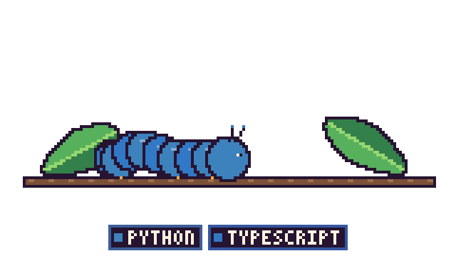
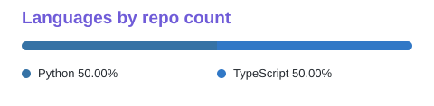

  <h1 align="center">
   🤗❤️✨ Welcome ✨❤️🤗
</h1>

<!-- Hero slideshow is generated from assets/scenes/*.jpg by assets/make_hero.py (needs Pillow). -->
  
# Hi, I'm Ram Rounak Mukherjee 👋
  

 

---

  
### 🦋 My Git Butterfly 🦋
 
  

---

## 🙋‍♂️ About Me

I build full-stack web applications, autonomous AI agents, and edge-first software — with a passion for building tools that function reliably where high-speed connectivity doesn't exist.

- 🌾 **Founder of "Rootra" & Lead Developer, Team Raven Roots**: 1st Place Winner at **Smart India Hackathon 2026** (Internal Selections across all 1st–4th year batches) with *AgriShield 365*.
- 🤖 **Autonomous Agents & MCP**: Architecting multi-agent reasoning graphs, schema-validated tool-calling pipelines, and Model Context Protocol (MCP) integrations.
- 📴 **Offline-First & Edge AI**: Developing field-ready PWAs and solar-powered hardware units with on-device vision inference (TFLite) for rural farmers.
- 🛰️ **Spatial & Vision Intelligence**: Engineering vision-language workflows for multimodal remote sensing, bi-temporal change detection, and optical–SAR fusion.
- 🎓 **Education**: B.Tech in Computer Science & Engineering at Swami Vivekananda Institute of Science & Technology, Kolkata.
- 📍 Based in **Kolkata, West Bengal, India**.

---

## 🚀 Featured Projects

### 🌾 Agritech & Real-World Resilience

#### 🛡️ [AgriShield 365](https://github.com/ramrounakmukherjee-blip/AgriShield365)
> **Every farmer, every season, protected.**
*1st Place Winner – Smart India Hackathon (SIH 2026) College-Wide Selections*

A farmer-first crop-health, irrigation intelligence, and risk-forecasting platform built for unpredictable climate conditions.
- 📸 **Visual Diagnosis**: Dual-engine leaf and pest symptom identification via Gemini Vision paired with local on-device heuristics.
- 💧 **JalRakshak Engine**: Scientific irrigation scheduling engineered to FAO-56 evapotranspiration standards.
- 🌦️ **Field Advisories**: Hyperlocal disaster warnings (Open-Meteo) and real-time mandi price updates.
- 📴 **Offline-First PWA**: Fully localized in 4 vernacular languages — English, हिन्दी, বাংলা, and मराठी.

`React` · `Vite` · `Tailwind CSS` · `FastAPI` · `Firebase` · `Gemini Vision` · `PWA`

 

#### ⚡ [AgriShield EDGE](https://github.com/ramrounakmukherjee-blip/AgriShield365)
> **Solar-powered, field-deployable Edge-AI hardware companion.**
*Smart India Hackathon Hardware Track — Problem Statement 26180*

A rugged IoT hardware twin designed for field-edge surveillance without requiring constant cloud connectivity.
- ☀️ **Self-Powered IoT Unit**: Integrates solar harvesting with environmental sensor probes (soil moisture, temperature, DHT) and high-resolution camera feeds.
- 🧠 **On-Device Assistant ("Lilly")**: Containerized local AI agent with scoped memory utilizing the **Model Context Protocol (MCP)** to orchestrate camera vision, FAO-56 sensor thresholds, and voice diagnostics.
- 📢 **Zero-Dependency Alerts**: Real-time localized voice readouts, onboard status indicators, and SMS alerts paired with opportunistic cloud sync.

`Edge AI` · `TensorFlow Lite` · `Model Context Protocol (MCP)` · `Python` · `IoT & Sensors`

 

#### ⚖️ [Kisan Nyay (किसान न्याय)](https://github.com/ramrounakmukherjee-blip/Kisan-Nyay)
> **Tamper-evident crop-loss audit & verifiable credit-proof platform.**

An offline-first evidence collection app enabling farmers facing extreme weather events to produce unalterable digital audit records for insurance and institutional bank loan claims.
- 📝 **Guided Evidence Collection**: Capture geotagged photographs, voice testimonies, crop damage parameters, and field metrics.
- 🔐 **Cryptographic Verification**: Computes local SHA-256 file fingerprints to guarantee chain-of-custody and document authenticity.
- ☁️ **Serverless Integration**: Built with AWS SAM serverless backend with SMS authentication and adjuster review dashboards.

`JavaScript` · `Python` · `AWS SAM` · `Serverless` · `Offline-First` · `Crypto Integrity`

---

### 🛰️ Spatial Intelligence & Autonomous Agents

#### 🛰️ [SatQuery AI](https://github.com/ramrounakmukherjee-blip/SATQUERY-AI)
> **Agentic vision-language assistant for multimodal remote sensing and satellite analytics.**

An interactive query platform translating natural-language questions into multi-step spatial and geospatial analyses.
- 🗺️ **Task Routing**: Intelligently decomposes complex spatial questions to specialized remote-sensing neural backbones.
- 🔄 **Temporal Analytics**: Single-scene land-use classification and bi-temporal change detection over multi-spectral satellite runs.
- 📡 **Optical–SAR Fusion**: Bridges optical and Synthetic Aperture Radar (SAR) imagery for all-weather geospatial visibility.
- 🤖 **Agentic Graph**: Implements LangGraph workflows with schema-validated tool-calling and traceable analytical reasoning exports.

`Python` · `LangGraph` · `FastAPI` · `PyTorch` · `GDAL` · `React`

 

#### 🧠 [Decide For Me](https://github.com/ramrounakmukherjee-blip/Decide-for-me)
> **You bring the dilemma — the engine brings the verdict.**

An AI decision engine that cuts through cognitive overload and decision paralysis.
- ⚖️ **Weighted Matrix**: Evaluates candidates against customized, user-defined life priorities and non-negotiables.
- 📉 **Downside Risk Index**: Models failure severity, recovery difficulty, and choice reversibility.
- ⏳ **10/10/10 Regret Framework**: Projects emotional and practical regret at 10 minutes, 10 months, and 10 years.
- ✅ **Execution Blueprint**: Synthesizes one definitive recommendation, a confidence metric, and an immediate step-by-step action plan.

`TypeScript` · `React` · `Firebase` · `AI Logic`

---

### 🚆 Systems & Engineering

#### 🚆 [Ticket To Ride](https://github.com/ramrounakmukherjee-blip/Ticket-To-Ride)
> **Full-stack Indian Railways booking simulation & high-concurrency engine.**

A comprehensive, interactive booking platform capturing the mechanics and operational constraints of the Indian rail network.
- 🛏️ **Coach Layout Visualizer**: Interactive LHB coach blueprints displaying real-time, date-scoped seat inventory.
- ⏱️ **Tatkal Queue Simulation**: 10-minute temporary seat-reservation locks and simulated high-concurrency waiting rooms.
- 🎟️ **Ticketing State Machine**: Waitlist (WL), Reservation Against Cancellation (RAC), and confirmed berth transition logic with digital ERS ticket generation.

`TypeScript` · `React` · `Express` · `Vite` · `Tailwind CSS` · `Docker`

---

## 🛠️ Tech Stack

### 🤖 AI, Multi-Agent Systems & Spatial

### 💻 Frontend & Offline-First Web

### ⚙️ Backend, Systems & Cloud

---

## 🌱 Currently Exploring & Researching

- 🤖 **Agentic Architectures**: Swarm coordination, self-correcting code agents, and Model Context Protocol (MCP) ecosystems.
- 🛰️ **Geospatial VLMs**: Advanced vision-language models for satellite time-series analysis and emergency disaster mapping.
- 📴 **Edge AI & Low-Power Inference**: Quantized model execution on battery- and solar-powered microcontrollers and microcomputers.
- 🔐 **Verifiable AI Workflows**: Zero-knowledge proof validation and cryptographic attestation for AI agent tool invocations.

---

## 📊 GitHub Stats

 
 

## ✍️ Random Dev Quote

  

---

## 📫 Let's Connect

 

*“Building resilient systems for the real world — from the silicon to the soil.”*

